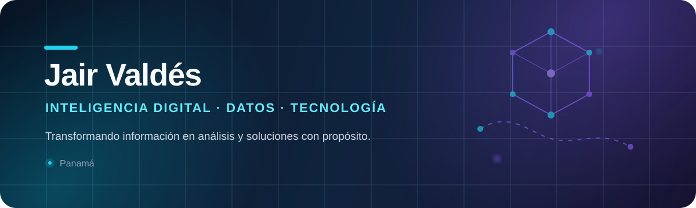
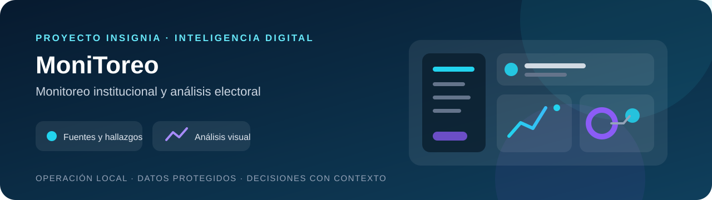
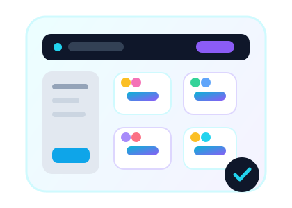
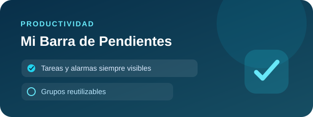

  

  
  

## Sobre mí

Soy **Jair Valdés**, profesional panameño de tecnología con experiencia en **inteligencia digital, monitoreo de medios y análisis de datos**. Me interesa transformar información compleja en hallazgos claros y convertir ideas en soluciones digitales útiles.

- 🔎 Analizo conversaciones, narrativas y patrones en entornos digitales.
- 📊 Exploro datos para apoyar decisiones y comunicar resultados con claridad.
- 💻 Desarrollo experiencias web y herramientas orientadas a necesidades reales.
- 🎓 Comparto conocimiento desde la docencia y el aprendizaje continuo.
- 🤖 Investigo cómo la inteligencia artificial está cambiando el trabajo y la creación de software.

## Áreas de enfoque

| Inteligencia digital | Datos y visualización | Desarrollo web | Educación y tecnología |
|:---:|:---:|:---:|:---:|
| Monitoreo de medios y análisis de narrativas | Power BI, Python y análisis de redes | Aplicaciones web, APIs y bases de datos | Experiencias de aprendizaje digitales |

## Tecnologías y herramientas

  

  
  
  

## Proyecto insignia

<table>
  <tr>
    <td colspan="2" valign="top">
      
      <h3>🔎 MoniToreo</h3>
      
Plataforma local de inteligencia digital para el monitoreo y análisis de información. Reúne contenidos de distintas fuentes, los clasifica y organiza para facilitar su revisión analítica.

      
Incluye panel operativo, acontecimientos y tendencias, programación de monitoreos, exportación y control por roles. El código, la base de monitoreo y los datos operativos permanecen privados.

      
      
      
      
    </td>
  </tr>
</table>

## Proyecto destacado

<table>
  <tr>
    <td width="68%" valign="top">
      <h3>🏫 Aula Encuentro</h3>
      

        Aula web interactiva para organizar equipos de una materia. Incluye perfiles y avatares,
        selección de grupos con cupos, chat privado, archivos adjuntos y un panel de administración docente.
      

      

        Construida con JavaScript y Supabase, con atención especial a permisos, privacidad y experiencia de usuario.
        Conserva además un prototipo local independiente en Node.js y SQLite.
      

      
      
    </td>
    <td width="32%" align="center" valign="middle">
      
    </td>
  </tr>
</table>

## Herramienta pública

<table>
  <tr>
    <td colspan="2" valign="top">
      
      <h3>✍️ TrazoJV</h3>
      
Herramienta web para añadir una firma visual a documentos PDF directamente en el navegador. Permite dibujarla, escribirla o importar una imagen, colocarla en las páginas y descargar el resultado.

      
Funciona sin registro y procesa el documento localmente, sin subirlo a un servidor. La firma insertada es visual y no sustituye una firma digital criptográfica certificada.

      
      
    </td>
  </tr>
</table>

## Prototipos funcionales

  Soluciones que he diseñado para resolver necesidades concretas de productividad,
  comunicación y análisis. Se muestran como portafolio; su código fuente y los datos
  procesados se mantienen privados.

<table>
  <tr>
    <td width="50%" valign="top">
      
      <h3>✅ Mi Barra de Pendientes</h3>
      
Organizador flotante para Windows con tareas, alarmas, repeticiones y grupos reutilizables. Permite mantener los pendientes visibles sin interrumpir el flujo de trabajo.

      
      
    </td>
    <td width="50%" valign="top">
      
      <h3>🎙️ Teleprompter Inteligente</h3>
      
Teleprompter flotante que sigue localmente la voz del presentador, espera durante improvisaciones y continúa al retomar el guion. Diseñado para acompañar presentaciones sin bloquear otras aplicaciones.

      
      
    </td>
  </tr>
  <tr>
    <td width="50%" valign="top">
      
      <h3>📝 TranscriPlus</h3>
      
Aplicación de escritorio para transcripción, subtítulos, revisión mediante OCR, biblioteca de contenidos y análisis local. Facilita comparar lo dicho con el texto visible en pantalla.

      
      
    </td>
    <td width="50%" valign="top">
      
      <h3>📊 Exportador autorizado de WhatsApp</h3>
      
Extensión interna para recopilar mensajes del chat abierto en un rango de fecha y hora y exportarlos de forma estructurada. Pensada para información autorizada, sin publicar conversaciones ni datos personales.

      
      
    </td>
  </tr>
</table>

## Actividad en GitHub

  <picture>
    <source media="(prefers-color-scheme: dark)" srcset="https://github-readme-stats.vercel.app/api?username=Jotauve24&show_icons=true&hide_border=true&bg_color=00000000&title_color=22d3ee&icon_color=8b5cf6&text_color=e5e7eb&locale=es" />
    
  </picture>
  <picture>
    <source media="(prefers-color-scheme: dark)" srcset="https://github-readme-stats.vercel.app/api/top-langs/?username=Jotauve24&layout=compact&hide_border=true&bg_color=00000000&title_color=22d3ee&text_color=e5e7eb&locale=es" />
    
  </picture>
  

---

  <strong>Datos, tecnología y pensamiento crítico para entender y construir el mundo digital.</strong>
    
  <a href="https://www.linkedin.com/in/jair-valdes-5213731a9/">Hablemos en LinkedIn</a>

